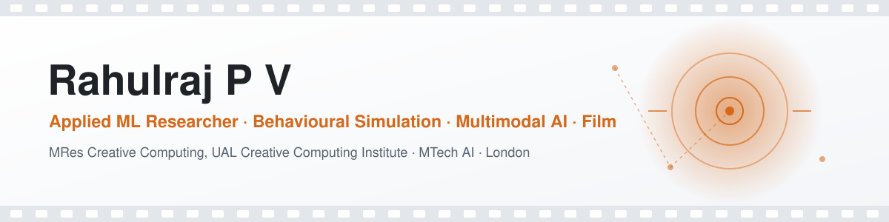
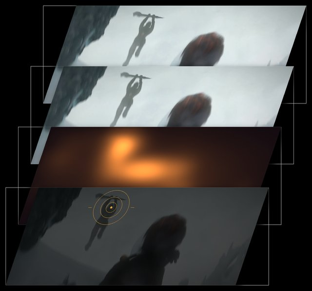
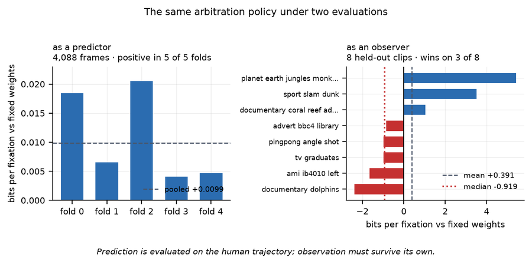
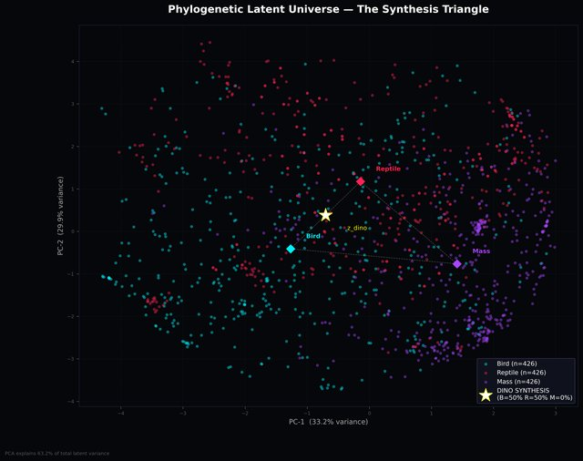

<picture>
  <source media="(prefers-color-scheme: dark)" srcset="assets/banner-dark.svg">
  
</picture>

  
  
  
  
  

  I build systems that <b>model how people watch, and act on what they see</b>, then test them against real human behaviour. 
  MRes Creative Computing at <b>UAL Creative Computing Institute</b> (with Prof. Tim J. Smith) · MTech in Computer Science &amp; Engineering (AI)

---

## 🎯 Featured: JOY, an Artificial Viewer

<table>
<tr>
<td width="42%" valign="top">

</td>
<td valign="top">

**A closed-loop observer that watches film.** JOY sees only a foveated percept and weighs bottom-up salience against a vision-language model's reading of the scene. It remembers where it has just looked, picks its own next fixation, and then perceives the world from wherever that choice left it.

**The central result is a dissociation.** The same arbitration policy that *improves prediction* of human gaze (positive in 5 of 5 folds) *wins on only 3 of 8 clips* when it is put in charge of the loop.

> Getting better at predicting gaze did not make it better at looking.

[**Project page & demo →**](https://joyaiviewer.vercel.app) &nbsp;·&nbsp; [repo](https://github.com/iamr7d/enjoy)

`computer vision` `vision-language models` `closed-loop agents` `behavioural simulation`

</td>
</tr>
</table>

  

---

## 🧪 Selected projects

<table>
<tr>
<td width="50%" valign="top">

### [MSPI-Tiny](https://github.com/iamr7d/mspi-tiny)
**Real-time attention on the edge.** Distils an offline audiovisual-attention model into interpretable decision-tree students. These drive a live camera assistant that gives framing guidance, targeting **<100 ms** per frame on Raspberry Pi / Jetson.

`knowledge distillation` `OpenCV` `scikit-learn` `edge AI`

</td>
<td width="50%" valign="top">

### [DinoSynthesis](https://github.com/iamr7d/DinoSynthesis)
**Generative paleo-acoustics.** A phylogenetic VAE-GAN in PyTorch interpolates between bird and reptile vocal latents to speculate on dinosaur sounds. It includes a full data pipeline (Xeno-canto, Freesound, SNR filtering, class rebalancing).

`PyTorch` `VAE-GAN` `CUDA` `generative audio`

</td>
</tr>
<tr>
<td valign="top">

### [FILMDA Player](https://github.com/iamr7d/filmda.play)
**Measuring audiences in real time.** A video player that tracks viewer engagement from blink detection and facial emotion, with a live analytics dashboard. Built for my MTech film-analytics thesis.

`computer vision` `emotion recognition` `Python`

</td>
<td valign="top">

</td>
</tr>
<tr>
<td valign="top">

### [GRAD0](https://github.com/iamr7d/GRAD0)
**An AI news director.** Aggregates RSS news, uses LLMs (LangChain) to curate and script stories, and auto-matches stock footage to build a TV-style run of show.

`LLM agents` `LangChain` `automation`

</td>
<td valign="top">

### [LumiMeet](https://github.com/iamr7d/lumi_meet)
**Personalised interview practice.** Generates interview questions tailored to your CV and the target job description with Google Gemini, behind a secure Node/Express proxy.

`Gemini` `LLM` `Node.js`

</td>
</tr>
</table>

<b>More experiments</b> (agentic media, VLMs, narrative analytics, physical computing)

 

| Project | What it is |
|---|---|
| [gradient.ai](https://github.com/iamr7d/gradient.ai) | Front end for an autonomous multi-agent newsroom, with a trust-gap analysis of AI media |
| [PEN.AI](https://github.com/iamr7d/PEN.AI) | Gemini-powered news platform aggregating RSS, Google News and NewsAPI |
| [ai_madhuri](https://github.com/iamr7d/ai_madhuri) | Node-based editor for Madhuri, an AI-run campus radio station |
| [wind.ai](https://github.com/iamr7d/wind.ai) | Presentation auditor using a vision-language model (Qwen-VL) |
| [film_space_vr-](https://github.com/iamr7d/film_space_vr-) | Film narrative as an explorable 3D manifold of LLM-inferred traces |
| [story-space](https://github.com/iamr7d/story-space) | Movie-plot analysis with the CMU Movie Summary Corpus and local LLMs |
| [Auto_encoders](https://github.com/iamr7d/Auto_encoders) | MNIST autoencoder in TensorFlow/Keras, with a Medium explainer |
| [AI-enabled-mini-games](https://github.com/iamr7d/AI-enabled-mini-games) | MediaPipe hand-tracking and pattern-learning games in Pygame |
| [clap](https://github.com/iamr7d/clap) | Arduino sound-reactive 10×10 LED matrix |

---

## 📄 Research

- **Rahulraj P. V.**, Sanil J., Anoop V. S., Asharaf S. (2023). *Monetize the Dual: A Data Analytic Approach for Native Language and Prequel Movie Popularity Analysis.* ICDAI, **Springer**. [DOI](https://doi.org/10.1007/978-981-99-3878-0_16)
- *Narrative DNA: DNA-Sequence Inspired AI-Driven Analysis of Narrative Dynamics in Movie Scripts.* Under review (2026).
- **MRes thesis:** *JOY: Building an Artificial Viewer for Sequential Visual Attention in Film* (UAL CCI, 2026)
- **MTech thesis:** *AI-Driven Film Analytics and Next-Generation Filmmaking* (Digital University Kerala, 2024)

## 🛠️ Toolbox

  
  
  
  
  
  
  
  
  
  
  
  
  
  
  

**Methods:** vision-language models (Qwen2.5-VL) · LoRA fine-tuning · multi-agent systems · RAG · saliency & attention modelling · sequence models · VAE/GAN · bootstrap-based evaluation

## 🎬 Beyond code

Filmmaker: directed three short films and contributed to 20+ films, ads and music videos; *Silent Spring* was selected for Amazon Prime UK. I was a Visiting Lecturer at UAL CCI (*The Mathematics of Cinema*) and have taught AI, Python and physics to 2,000+ learners.

Open to Applied Scientist, ML Research and Creative Technologist roles in the UK · <a href="mailto:rahulrajpv.ai@gmail.com">get in touch</a>

